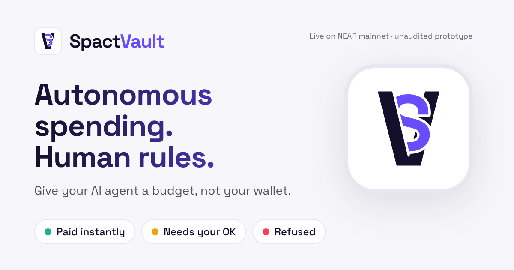

# SpactVault

*Autonomous spending. Human rules.*



SpactVault (Spact for short) is a payment-policy firewall for AI agents on NEAR. An agent asks a NEAR vault contract to pay someone. The contract enforces the owner's limits on-chain. Anything above the auto limit waits until the owner approves that exact payment from their wallet.

> **Unaudited hackathon prototype.** It runs on NEAR mainnet with small amounts of real USDC. Keep amounts small.

## Why not just give the agent a wallet

A wallet key can spend everything. A NEAR function-call key restricts which methods can be called, but its `allowance` caps gas, not dollars. SpactVault puts the rules in a contract the agent cannot change:

- **on-chain budgets:** per-payment auto limit, hard cap, and a UTC-day budget that counts in-flight transfers, so parallel requests cannot overspend
- **approval bound to exact terms:** the owner approves a hash of the stored request (recipient, amount, token, vault, network, policy version), signed with a full-access key. A backend or bot that shows different terms produces a hash the vault rejects.
- **no replay:** each request id executes at most once; the transfer callback settles exactly once
- **tests that attack it:** the Security Lab runs the bypass attempts against a real local NEAR node, and its page shows each attack with the test results behind it

## What works today

| Piece | State |
|---|---|
| Vault contract (`contracts/spact-vault`) | built, 66 unit tests (15 for the P1 cross-chain route) |
| Real-chain tests on a NEAR sandbox node (`contracts/integration-tests`) | 19 passing: auto payment, approval flow, parallel split, failed transfer, private callback, agent bypass attempts, init front-run, pause/recovery, the agent's restricted key, expiry, wrong vault or policy, and the cross-chain route (deposit and payee bound apart, returned tokens never restore budget, expired quote, unlisted route) |
| Shared TS package: request hash, exact amounts, contract JSON schemas, reason codes, RPC client (`packages/shared`) | built, 26 tests; hash matches Rust and independent Python vectors, direct and cross-chain |
| Landing page, owner dashboard and approval page (`apps/web`) | built, with tampered RPC answers, framing, the network switch and the cross-chain review page tested in a browser on a local chain |
| Owner tools on the website: create a vault, fund it, rules, pause, agents, agent key, cross-chain page (`apps/web`, ADR-033) | built and tested in a browser on a local chain, every flow end to end; **not yet run with Meteor on mainnet** |
| Hosted site | live at https://spactvault.xyz (Railway) and https://0xileri.github.io/SpactVault/ (GitHub Pages), both from main, reading the mainnet vault with a switch to the testnet vault |
| Security Lab report and page (`packages/security-lab`, `?page=security`) | built: 17 of 18 attack cases pass on a local chain, T10 in unit tests only, none uncovered (329 tests in 11 suites, 2026-11-03) |
| Agent MCP server for Claude Code / Codex (`apps/mcp`) | built, with direct and cross-chain tools; tested over stdio on a local chain; run from Claude Code on testnet and **on mainnet with real USDC** (paid, held for approval, blocked). The cross-chain tool is tested against a mock 1Click only |
| Local demo with no wallet or testnet needed (`scripts/dev-sandbox.sh`) | works |
| Testnet deploy script (`scripts/deploy-testnet.sh`) | ran on testnet on 2026-10-25: `vault.spact-ileri2.testnet` |
| Signing with a real wallet | done with Meteor Wallet on testnet (25 TUSD) and on **mainnet** (2 USDC, 2026-11-03): the owner approved and paid the waiting request on the hosted site. Other wallets untested |
| Telegram alert for the owner (`apps/notifier`) | built, 28 unit tests and 4 tests on a local chain against a mock Bot API; not yet tried with real Telegram |
| NEAR Intents / 1Click cross-chain route (P1) | vault route, 1Click adapter (`packages/intents`), MCP tool, approval page check against 1Click's record, live status tracking and Telegram alert, all tested on a local chain with a stand-in deposit account and a mock 1Click, plus real 1Click quote and status answers recorded on 2026-11-03 (1Click's signatures on them verify); **no live payment yet, not on testnet or mainnet** (the deployed vaults run the earlier code). See DECISIONS ADR-032 to ADR-034 |

Details: [docs/STATUS.md](docs/STATUS.md). Security mapping: [docs/THREAT_MODEL.md](docs/THREAT_MODEL.md).

## Let Claude Code or Codex pay

`apps/mcp` is an MCP server with three tools: `request_payment`, `request_cross_chain_payment` (through 1Click, only with `ENABLE_1CLICK_LIVE=true`, always waits for the owner) and `get_payment_status`. It signs with the agent's function-call key and refuses to start with a full-access key. `scripts/dev-sandbox.sh` prints the `claude mcp add` and `codex mcp add` commands for the local chain. Then ask the agent to pay `api.test.near` 5 TUSD (paid at once) or 20 TUSD (it gets an approval link and waits for you). Setup for testnet: [apps/mcp/README.md](apps/mcp/README.md). On testnet, Claude Code paid 5 TUSD at once, waited for the owner on 12 TUSD, and was blocked paying `evil.testnet` (docs/STATUS.md).

## Run your own vault from the website

Everything the owner does happens on https://spactvault.xyz with a browser wallet such as Meteor. No terminal. The site shows what each step does before your wallet asks you to sign, and on mainnet the Sign button stays off until you tick that you checked it (DECISIONS ADR-033). The only part that is not in the browser is your agent, which runs the MCP server on its own machine. Mainnet uses real funds: keep amounts small.

1. **Connect.** Open https://spactvault.xyz, pick **Mainnet** in the top bar, open **Dashboard**, and click **Connect NEAR wallet**. You see your account (for example `0xileri.near`) in the page header.
2. **Create a vault.** Open the **New vault** tab and keep **Any wallet** (the default; Meteor refuses the named way, see DECISIONS ADR-036). Keep `agent2.<your account>` as the agent, native USDC as the token, 3.2 NEAR for storage and the limits 1 / 3 / 5. Click **Review**. You see **Step 1 of 2: create** a 64-character address, and one wallet action: *Send 3.2 NEAR* to it. All of that NEAR stays in the vault for good. Tick the mainnet box, click **Sign in your wallet**, check that Meteor shows the same address, and approve. Then you see **Step 2 of 2** with the code hash `5HwAUrjKbx5qc7NNyka4ndkAsXUdA9CsQ1ya66zzNNve`. Click **Install and lock**; this tab signs it, so there is no wallet prompt. You see **Running and locked**, with a check for the matching code hash and **No access keys**. Keep the tab open until then. With a wallet that allows websites to install contract code, **With a name under your account** gives the vault a name like `vault2.<your account>` instead (ADR-035).
3. **Add money.** Click **Next: add money and give your agent a key**. Under **Add money**, click **Add tokens**, enter `3`, and click **Review**. You see a `storage_deposit` (once) and an `ft_transfer` to the vault. Sign. You see **Confirmed on chain** and **3 USDC in the vault**.
4. **Give your agent a key.** Under **Give your agent a key**, click **Set up an agent key**, keep `agent2`, and click **Make the key**. Click **Download agent2.….json**. Then review and sign the transaction that creates `agent2.<your account>` with a key that can only call `request_direct_payment`, `request_cross_chain_payment` and `execute_request` on the vault. You see **agent2.… is ready** and the MCP settings for your agent. If your wallet refuses that transaction, pick **Any wallet** instead: the wallet only sends NEAR to a new 64-character account, this tab swaps in the restricted key, and then you sign `add_agent`. Put the file on the agent's machine, readable only by that user (`chmod 600`), and start the MCP server there with those settings ([apps/mcp/README.md](apps/mcp/README.md)).
5. **Allow a cross-chain destination.** Open the **Cross-chain** tab. Pick **USDC on Solana** (or Base), paste the recipient's address, enter `1`, and click **Get a price**. You see what the vault sends, what arrives, the minimum, and the fee. Click **Allow this recipient in your rules**, review the one-line change, and sign.
6. **Let the agent pay, and approve.** Ask your agent to pay that address 1 USDC. It calls `request_cross_chain_payment`, which files a real 1Click quote with the vault, and you get an approval link (and a Telegram alert, if set up). Open it. You see the deposit address and the final recipient apart, **1Click confirms this deposit address**, and **Approve and pay**. If 1Click's record does not match, Approve stays off. Approve in Meteor.
7. **Follow it.** The same page then shows **1Click:** with its status, checked every 5 seconds, and links to the transactions on NEAR and on the destination chain once 1Click reports them.

Rules, pause, agents and withdrawals are under **Manage**: change the limits or recipients (the review lists each change in words), **Pause all payments**, add or remove agents, and **Take money out** (tokens only, to your account by default). Each is one wallet signature. The NEAR you send when creating a vault stays in it for good: the vault has no way to send NEAR out (DECISIONS ADR-036).

What has not been tried yet: these flows with Meteor on mainnet (the local tests use a stand-in signer), and the live 1Click API (docs/STATUS.md). Wallet limits and their browser-only workarounds are in DECISIONS ADR-033 and ADR-035, with a table of what each step asks the wallet to allow.

## Security Lab

```bash
scripts/security-report.sh
```

This runs every suite, then builds `apps/web/public/security-report.json` from the runners' own output. Open `http://localhost:5173/?page=security` while `scripts/dev-sandbox.sh` is running. Each attack from AGENTS.md section 10 is listed with the exact tests behind it, their results and where they ran. The page also shows the commit, the run, and a sha256 of each raw output file. A case passes on a local chain only if every listed test passed and at least one ran against a NEAR node. The page recomputes that itself instead of trusting the file. In CI the same report is the `security-report` artifact of each run.

## Live on mainnet and testnet

**Unaudited prototype.** The mainnet vault holds 5 real USDC with small fixed limits. Testnet uses TUSD, a test token with no value. The switch in the site's top bar moves between them.

| | Mainnet | Testnet |
|---|---|---|
| Site | https://spactvault.xyz (also https://0xileri.github.io/SpactVault/) | the same site, switched to **Testnet** (`?network=testnet`) |
| Vault | [`vault.0xileri.near`](https://nearblocks.io/address/vault.0xileri.near), code locked (no access keys) | [`vault.spact-ileri2.testnet`](https://testnet.nearblocks.io/address/vault.spact-ileri2.testnet), code hash `bb664f2a1b19734e5bbb8f01372d737fcc724ae008be284603c7dd4dc191c81c` |
| Owner (approves in Meteor Wallet) | [`0xileri.near`](https://nearblocks.io/address/0xileri.near) | [`0xileri.testnet`](https://testnet.nearblocks.io/address/0xileri.testnet) |
| Agent (function-call key for two vault methods only) | [`agent.0xileri.near`](https://nearblocks.io/address/agent.0xileri.near) | [`agent.spact-ileri2.testnet`](https://testnet.nearblocks.io/address/agent.spact-ileri2.testnet) |
| Token / payee | native USDC / [`api.0xileri.near`](https://nearblocks.io/address/api.0xileri.near) | [`tusd.spact-ileri2.testnet`](https://testnet.nearblocks.io/address/tusd.spact-ileri2.testnet) / [`api.spact-ileri2.testnet`](https://testnet.nearblocks.io/address/api.spact-ileri2.testnet) |
| Limits | paid at once up to 1 USDC, waits up to 3, 5 a day | paid at once up to 10 TUSD, waits up to 30, 50 a day |

**Mainnet demo payments (2026-11-03),** made by the agent from Claude Code through the MCP server, all to the owner's own payee:

| Request | What happened | Transaction |
|---|---|---|
| 0.5 USDC | paid at once (under the 1 USDC instant limit) | [`3ABgwMWy…`](https://nearblocks.io/txns/3ABgwMWyKiS24AYtHSXgzVggekiNx5cb6xi3EucNqiJP) |
| 2 USDC | waited; the owner approved and paid it with Meteor Wallet | request [`39dMJm5x…`](https://nearblocks.io/txns/39dMJm5xkDyqw5Mdjjm1JoNdLBkPrwwoJnQMPQaNN6HV), approval [`RqphTo2H…`](https://nearblocks.io/txns/RqphTo2Hy9ifsW7Y2PDXFM2A8gtcxu6GHdBuzfcP2oB) |
| 4 USDC | blocked (over the 3 USDC limit per payment); nothing sent | refused request [`dpwtTTim…`](https://nearblocks.io/txns/dpwtTTimLp3Sq4RJcXpa3S45zcLdUwZ2bABHRKe22Q3) |

On testnet the deploy script made two agent requests: 3 TUSD, paid automatically, and 25 TUSD, which the owner approved and paid from the site with Meteor Wallet. The testnet code hash is from the owner's build; a build on another machine gives a different hash for now (docs/STATUS.md).

## Hosted site

After every job passes on main, CI publishes the site to GitHub Pages at https://0xileri.github.io/SpactVault/, with the Security Lab report from that same run. `/` is a landing page that states the vault's limits as read from its policy and shows live numbers from chain; the owner dashboard is `?page=overview`, the Security Lab `?page=security`, Privacy and terms `?page=legal`, and approval links stay `?request=<id>`. Nobody uploads the report by hand. A build without a vault id is the Security Lab alone; the overview and approval links then say that no vault is connected.

Repository settings this needs: Settings → Pages → Source **GitHub Actions** (once), and repository variables under Settings → Secrets and variables → Actions → Variables:
- `VITE_NEAR_NETWORK`, `VITE_NEAR_RPC_URL` and `VITE_VAULT_ID` for the main network, now `mainnet`, `https://rpc.mainnet.fastnear.com` and `vault.0xileri.near`. Without them the build defaults to testnet and `https://test.rpc.fastnear.com`.
- Optional, for the network switch: `VITE_TESTNET_VAULT_ID`, now `vault.spact-ileri2.testnet` (with `VITE_TESTNET_RPC_URL`, default `https://test.rpc.fastnear.com`). On a testnet-first site, use `VITE_MAINNET_VAULT_ID` and `VITE_MAINNET_RPC_URL` instead.
- Optional, for more than one vault on a network: `VITE_EXTRA_VAULTS` (comma-separated, each `account` or `account=label`), plus `VITE_VAULT_LABEL` for the default vault, e.g. `VITE_VAULT_ID=vault2.0xileri.near`, `VITE_VAULT_LABEL=P1 vault`, `VITE_EXTRA_VAULTS=vault.0xileri.near=P0 vault`. A picker in the page header then moves between them (ADR-033). A vault the site does not list still opens if it runs a SpactVault build the site knows and has no access keys.

After changing them, re-run the workflow on main. These are public values, not secrets.

The switch keeps you on the same page and adds `?network=testnet` to every link while you are on the second network. Approval links from the MCP server and the Telegram alert name their vault (`?request=<id>&vault=<vault>`), so they open on the right network on their own (DECISIONS ADR-031).

## Deploy to Railway

The root `Dockerfile` builds the site and serves it with Caddy, which sends security headers that GitHub Pages cannot, such as `X-Frame-Options: DENY` (DECISIONS ADR-025). CI builds and checks the same image on every push (`web-image` job).

1. At https://railway.com create a project from the GitHub repo. If Railway offers one service per package, keep a single service at the repository root. Its build log says `Using detected Dockerfile!`.
2. Under the service's **Variables**, set the main network: here `VITE_NEAR_NETWORK=mainnet`, `VITE_NEAR_RPC_URL=https://rpc.mainnet.fastnear.com` and `VITE_VAULT_ID=vault.0xileri.near`. For the network switch, add `VITE_TESTNET_VAULT_ID=vault.spact-ileri2.testnet`. The other settings have defaults in the `Dockerfile`: testnet, `https://test.rpc.fastnear.com`, the second network's RPC, the Security Lab report from the GitHub Pages site, and this repository's link.
   The same `VITE_VAULT_LABEL` / `VITE_EXTRA_VAULTS` work here. 1Click needs nothing: the image proxies it at `/1click` and the build points there by default (`VITE_ONECLICK_URL`).
3. Under **Settings → Networking**, generate a domain or add your own; this project uses `spactvault.xyz`. The share card uses the generated domain automatically (`RAILWAY_PUBLIC_DOMAIN`). For a custom domain, also set `VITE_SITE_URL=https://<your domain>`.
4. Under **Settings**, turn on **Wait for CI**, so Railway deploys a commit only after GitHub Actions passed on it.
5. When it is up, check it: `scripts/check-web-image.sh https://<domain> https://<domain>`.

Cost: Railway's trial is a one-time $5 for 30 days. After that the Free plan includes $1 a month, or Hobby is $5 a month.

## Get a Telegram alert

`apps/notifier` messages you when a payment waits for your approval: the exact terms plus a link to the approval page. It messages again when the payment is paid. The bot can't approve anything; your wallet does. Link your chat once with a code the notifier prints on its terminal. Setup: [apps/notifier/README.md](apps/notifier/README.md).

## Try the approval flow locally

No wallet, testnet or funds needed. One command starts a local NEAR chain with a funded vault, a local signer holding the sandbox owner key, and the approval page.

```bash
pnpm install --frozen-lockfile
scripts/dev-sandbox.sh
```

1. Wait for `Open http://localhost:5173/?request=demo-approve-1` and open it. You see **25 TUSD to api.test.near**, status **Waiting for you**, the agent's note, why it waits (over the **10 TUSD instant limit**), a green **Safety check passed** box, and **47 TUSD of 50** left to spend today.
2. Click **Connect Local sandbox signer**. The header shows `owner.test.near`.
3. Click **Approve and pay**. You see **Done: approved and paid** with a transaction hash, the status turns **Paid**, and the page says **You approved it, and it was sent.**
4. Open http://localhost:5173/?page=overview, the dashboard. The demo request shows as **Paid** under **What your agent did**, **Left to spend today** shows **22 TUSD of 50 TUSD**, and **Money in the vault** shows **972 TUSD**. One request is still **Waiting for your OK**: the cross-chain one below.
5. **Cross-chain route (P1, simulated).** Open http://localhost:5173/?request=demo-cross-chain-1. You see **5 TUSD to 7EcDh… on sol, through NEAR Intents 1Click**, with the **1Click deposit address on NEAR** (`deposit.test.near`) and the **final recipient** listed apart, **Refunds go to** `vault.test.near`, why it waits (cross-chain payments always do, whatever the amount), and **1Click confirms this deposit address**. Click **Approve and pay**. You see **Done: approved and sent to the 1Click deposit address**, the status turns **Sent to 1Click**, then **1Click: Delivered, says 1Click** with a Solana link, and the dashboard shows **17 TUSD of 50 TUSD** left. This is a simulation: `deposit.test.near` is a local account standing in for a 1Click deposit address, "1Click" is a mock server on localhost that answers from the local chain, and nothing reaches Solana. The vault's part (exact amount, exact deposit account, owner approval, budget spent) is real chain behavior; 1Click's part is not exercised.
6. **Owner tools.** Open the **New vault**, **Manage** and **Cross-chain** tabs. Everything in "Run your own vault from the website" works here against the local chain, with the local signer instead of a wallet.

To watch the attacks fail, run `pnpm e2e`. It drives Chromium against the same local setup, and you see `41 passed`, including every owner flow from "Run your own vault from the website" against the local chain. Three of those tests rewrite the RPC response on its way to the page:

- **Recipient changed, hash kept:** the page shows **Safety check failed: do not approve** and the approve button is disabled.
- **Recipient and hash both forged:** the page shows the attacker's terms with a passing check, the owner approves, and the vault refuses with `HASH_MISMATCH`. The test then reads the chain directly: nothing moved and the request still awaits approval.
- **Budget inflated:** the dashboard sees that the numbers don't add up and shows **Today's spending numbers do not add up** instead of them.

## Deploy from the command line (developers)

The website is the owner's way to create a vault (above). Before it existed, the testnet and mainnet vaults were deployed with `scripts/deploy-testnet.sh` (2026-10-25) and `scripts/deploy-mainnet.sh` (2026-11-01, `vault.0xileri.near`). Both still work, are rehearsed against a local node (`scripts/rehearse-deploy-sandbox.sh`, `scripts/rehearse-mainnet-sandbox.sh`), and explain themselves in their headers. They need bash, rustup, Node 22.12+ and near-cli-rs, and the mainnet one waits for you to type `deploy to mainnet`. They give the agent the older two-method key, which cannot file cross-chain requests.

## Run the tests

Prerequisites: rustup (run `rustup toolchain install` inside `contracts/` to get the pinned 1.97.0 toolchain and wasm target), Node 22.12+, pnpm 10, and a C compiler (only used in containers with a low open-file limit).

```bash
# contracts: build wasm, unit tests, then sandbox tests on a local NEAR node
scripts/test-contracts.sh

# TypeScript
pnpm install --frozen-lockfile
pnpm lint && pnpm typecheck && pnpm test && pnpm build
```

Expected: `51 passed` (vault unit), `1 passed` (mock token), `10 passed` (sandbox), `19 passed` (shared), `30 passed` (web), `24 passed` (mcp), `27 passed` (notifier) and `8 passed` (security-lab). `pnpm mcp:sandbox` runs the MCP server over stdio against a local chain: `11 passed`. `pnpm notifier:sandbox` runs the notifier against a local chain and a mock Bot API: `4 passed`. The first sandbox run downloads the NEAR sandbox node binary.

On testnet or mainnet the page uses a real wallet through near-connect. Configure it with `apps/web/.env.example`.

## NEAR technology used

- **NEAR smart contract** (Rust, near-sdk 5.29.1): policy, budgets, approvals, the request state machine
- **NEP-141** fungible tokens: the vault pays with `ft_transfer` and checks the result in a private callback
- **Access keys:** owner actions require 1 yoctoNEAR, which function-call keys cannot attach, so only a full-access (wallet) signature can approve or change policy. The protocol rejects the attempt with `DepositWithFunctionCall`, as a sandbox test shows.
- **Function-call access keys:** the agent signs with a key that can call only the vault's `request_direct_payment` and `execute_request`. A leaked agent key cannot move NEAR, add keys or call anything else; sandbox tests show each protocol rejection.
- **NEP-297 events** for every state change
- **NEAR Connect** (`@hot-labs/near-connect`) for owner wallets on testnet and mainnet, with each wallet's code in a sandboxed iframe
- **NEAR JSON-RPC**: the approval page reads the vault directly, with no backend in between
- **MCP** (`@modelcontextprotocol/server`): the agent's tools, backed by its function-call key

- **NEAR Intents 1Click** (P1, built and tested locally and against recorded live answers, **no live payment yet**): the vault pays a 1Click quote's NEAR deposit address only after the owner approves the exact deposit address and destination; `packages/intents` builds and checks quotes and reads 1Click's status without ever trusting it to restore budget (DECISIONS ADR-032).

## Repo map

```text
AGENTS.md                 canonical product + security spec (read first)
contracts/                Rust workspace: vault, mock token, sandbox tests
apps/web/                 owner approval page, dev signer, browser tests
apps/mcp/                 the agent's MCP server (stdio) and its sandbox tests
apps/notifier/            Telegram alerts for the owner, with a mock Bot API for tests
packages/shared/          TS types, request digest, amount helpers, JSON schemas, RPC client
packages/security-lab/    builds the Security Lab report from test output; catalog of attacks
scripts/                  build and test scripts
docs/                     architecture, threat model, decisions, status, integrations
```
